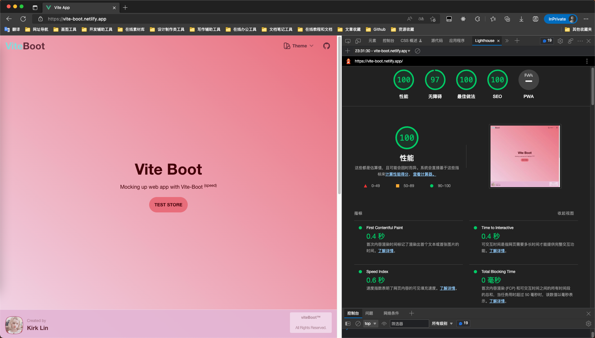

<div align='center'>
<h1>Boot-Vue </h1>

</div>

<p align='center'>
使用Boot-Vue快速地创建 Web 应用
</p>

## 特性

- ⚡ [闪电般的速度](https://github.com/kirklin/boot-vue#readme)：使用 Vue 3、Vite 和 pnpm 构建，速度飞快 🔥
- 💪 [强类型](https://www.typescriptlang.org/)：使用 TypeScript 💻
- 🔥 [最新语法](https://github.com/vuejs/rfcs/pull/227)：使用新的 <script setup> 语法 🆕
- 📦 [自动导入组件](./src/components)：自动导入组件 🚚
- 📥 [自动导入 API](https://github.com/antfu/unplugin-auto-import)：使用 unplugin-auto-import 直接导入 Composition API 和其他 API 📨
- 🎨 [Tailwind CSS](https://tailwindcss.com/) - 以工具类为主的 CSS 框架，通过官方 Vite 插件接入
- 🧩 [shadcn-vue](https://www.shadcn-vue.com/) - 基于 Reka UI 的无障碍组件，代码放在 `src/components/ui`，可以直接修改
- 🌓 [深色模式](./src/layouts/Navbar/components/ThemeChange)：浅色、深色或跟随系统，切换时新主题从点击位置以圆形展开 🌗
- 💡 [官方路由器](https://router.vuejs.org/)：使用 Vue Router v5 🛣️
- 🎉 [加载反馈](https://github.com/rstacruz/nprogress)：使用 NProgress 提供页面加载进度反馈 🔄
- 🍍 [状态管理](https://pinia.vuejs.org/)：使用 Pinia 进行状态管理 🗃️
- 📜 [中文字体栈](./src/styles/main.css)：中文优先的字体设置，中文标点使用中文字形 🇨🇳
- 🌍 [国际化就绪](./src/locales)：使用本地化准备好国际化 🌎
- ☁️ [Netlify 就绪](https://www.netlify.com/)：可在 Netlify 上零配置部署 ☁️

### 编码风格

- [@kirklin/eslint-config](https://github.com/kirklin/eslint-config)

### 推荐的 IDE 设置

- 🌪️ [WebStorm](https://www.jetbrains.com/webstorm/)
- 💻 [VSCode](https://code.visualstudio.com/)
- 💡 [Vue - Official](https://marketplace.visualstudio.com/items?itemName=Vue.volar)

### 性能



## 项目结构

```
# boot-vue
├─.github                                # 存储 GitHub 相关配置文件。
│  ├─ISSUE_TEMPLATE                       # GitHub Issue 模板
│  └─workflows                            # GitHub Actions 相关配置文件
├─.husky                                  # 存储 Git Hooks 相关配置文件
│  └─_                                    # 存储 Git Hooks 执行脚本
├─.vscode                                 # 存储 VS Code 相关配置文件
├─public                                  # 存储 Web 应用所需的静态资源
├─README.assets                           # 存储 README.md 使用的图片等资源
├─src                                     # 存储 Web 应用源代码
│  ├─assets                               # 存储 Web 应用所需的静态资源
│  ├─components                           # 存储 Web 应用的组件
│  │  └─ui                                # 存储 shadcn-vue 命令行添加的组件
│  ├─composables                          # 存储 Web 应用的组合式函数
│  ├─config                               # 存储 Web 应用的配置文件
│  │  └─nprogress                         # 存储进度条库 NProgress 的配置文件
│  ├─constant                             # 存储 Web 应用中使用到的常量值
│  ├─layouts                              # 存储 Web 应用的布局组件
│  │  ├─Footer                            # 存储表示页面底部的布局组件
│  │  └─Navbar                            # 存储表示页面导航栏的布局组件
│  │      └─components                    # 存储 Navbar 布局组件的子组件
│  │          ├─LocalesChange             # 存储表示语言切换的子组件
│  │          └─ThemeChange               # 存储表示主题切换的子组件
│  ├─lib                                  # 存储组件共用的工具函数，例如 `cn`
│  ├─locales                              # 存储 Web 应用的多语言内容文件
│  ├─pages                                # 存储 Web 应用的页面组件
│  │  ├─errorPages                        # 存储表示错误页面的组件
│  │  └─home                              # 存储表示主页的组件
│  │      └─components                    # 存储主页组件的子组件
│  ├─router                               # 存储 Web 应用的路由配置文件
│  │  └─routes                            # 存储 Web 应用路由的模块
│  │      └─modules                       # 存储 Web 应用路由模块的子模块
│  ├─store                                # 存储 Web 应用的状态管理文件
│  └─styles                               # 存储 Tailwind CSS 入口文件和主题变量
├─test                                    # 存储测试代码
└─types                                   # 存储 TypeScript 类型声明文件

```

## 快来试试吧！！

> Boot-Vue 需要 Node.js 22.22.2 及以上、24.15.0 及以上或 26 及以上版本

### GitHub 模板

[使用这个模板创建仓库](https://github.com/kirklin/boot-vue/generate).

### 克隆到本地

```bash
npx degit kirklin/boot-vue my-app
cd my-app
pnpm i
```

## 使用

### 开发

只需要执行以下命令就可以在 http://localhost:8888 中看到

```bash
pnpm run dev
```

### 构建

构建该应用只需要执行以下命令

```bash
pnpm run build
```

然后你会看到用于发布的 `dist` 文件夹被生成。

### 添加组件

用 shadcn-vue 的命令行把更多[组件](https://www.shadcn-vue.com/docs/components)添加到 `src/components/ui`

```bash
pnpm dlx shadcn-vue@latest add dialog
```

### 部署到 Netlify

前往 [Netlify](https://app.netlify.com/start) 并选择你的仓库, 一路 `OK` 下去，稍等一下后，你的应用将被创建.

### Docker Production Build

首先，在项目的根目录下打开终端，构建vite-boot镜像。

```bash
docker buildx build . -t viteboot:latest
```

运行镜像，用 "-p" 指定端口映射。

```bash
docker run --rm -it -p 8080:80 viteboot:latest
```
